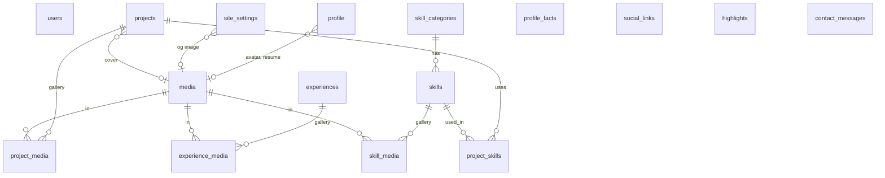

# DATABASE.md

Skema PostgreSQL. **Skema adalah kontrak:** ubah dokumen ini, buat migrasi baru, dan perbarui `packages/shared` bersamaan. Jangan mengedit migrasi yang sudah pernah dijalankan.

## Konvensi

- Nama tabel dan kolom `snake_case`, tabel jamak. JSON respons API `camelCase` (dikonversi di serializer).
- Kunci utama `id` integer auto-increment, kecuali tabel tunggal (singleton).
- `created_at` dan `updated_at` bertipe `timestamptz`.
- `sort_order` integer, default 0. Endpoint reorder menuliskannya ulang berurutan.
- Kolom bertipe enum disimpan sebagai `varchar` dengan `CHECK`, nilainya didefinisikan di `packages/shared/src/index.ts`.
- Slug huruf kecil, angka, dan tanda hubung. Unik.
- Hapus bersifat keras (tanpa soft delete). Penghapusan media menghapus berkasnya setelah transaksi sukses.

## Diagram relasi

## Tabel

### users
Admin tunggal. Tidak ada endpoint pendaftaran.
| Kolom | Tipe | Catatan |
|---|---|---|
| id | int PK | |
| email | varchar(254) | unik, disimpan huruf kecil |
| password | varchar(255) | hash bawaan Adonis |
| full_name | varchar(120) | |
| created_at, updated_at | timestamptz | |

### profile (singleton)
`id smallint PK default 1 CHECK (id = 1)`
| Kolom | Tipe | Catatan |
|---|---|---|
| full_name | varchar(120) | wajib |
| hero_prefix | varchar(60) | sapaan awal di hero, mis. "Halo, saya" (null boleh) |
| display_name | varchar(60) | sapaan di hero, mis. "Ibnu" |
| headline | varchar(160) | mis. "Frontend Developer dan QA Tester" |
| tagline | varchar(280) | null boleh |
| hero_intro_md | text | paragraf pembuka |
| about_md | text | bagian Tentang |
| location | varchar(120) | null boleh |
| email_public | varchar(254) | null boleh |
| phone_public | varchar(40) | null boleh |
| availability_text | varchar(160) | mis. "Terbuka untuk magang", null boleh |
| avatar_media_id | int FK media | `ON DELETE SET NULL` |
| resume_media_id | int FK media | `ON DELETE SET NULL` |
| updated_at | timestamptz | |

### profile_facts
`id, label varchar(60), value varchar(200), sort_order, is_visible bool default true`

### social_links
`id, platform varchar(20) CHECK in SOCIAL_PLATFORMS, label varchar(60), url text, media_id int FK media null ON DELETE SET NULL, sort_order, is_visible`
Untuk `platform = 'email'`, `url` berbentuk `mailto:`.

### highlights
Angka besar. `id, placement varchar(10) CHECK in ('about','skills'), value varchar(40), label varchar(120), note varchar(200) null, sort_order, is_visible`
Nilai ditulis apa adanya oleh pemilik (mis. "±580"). Sistem tidak menghitung.

### skill_categories
`id, name varchar(80), slug unique, description varchar(280) null, accent varchar(10) CHECK in ('red','yellow') default 'red', sort_order, is_visible, created_at, updated_at`

### skills
| Kolom | Tipe | Catatan |
|---|---|---|
| id | int PK | |
| category_id | int FK skill_categories | `ON DELETE RESTRICT` |
| name | varchar(80) | unik per kategori |
| slug | varchar(100) | unik global |
| level | varchar(12) null | `learning`, `comfortable`, `strong`. Tanpa persentase |
| summary | varchar(280) | satu kalimat |
| description_md | text null | isi halaman detail |
| years_experience | numeric(3,1) null | |
| is_visible | bool default true | |
| sort_order | int | |
| created_at, updated_at | timestamptz | |

### projects
| Kolom | Tipe | Catatan |
|---|---|---|
| id | int PK | |
| slug | varchar(120) | unik |
| title | varchar(160) | |
| summary | varchar(320) | untuk kartu |
| description_md | text | halaman detail |
| role | varchar(120) null | peran pemilik |
| kind | varchar(60) null | label bebas: Website, QA, Mobile |
| status | varchar(10) | `draft` (default), `published`, `archived` |
| is_featured | bool default false | tampil di beranda |
| demo_url, repo_url | text null | harus `https://` |
| started_on, ended_on | date null | |
| cover_media_id | int FK media | `ON DELETE SET NULL` |
| sort_order | int | |
| published_at | timestamptz null | diisi saat pertama terbit |
| created_at, updated_at | timestamptz | |

Indeks: `(status, sort_order)`, parsial `is_featured` untuk `status = 'published'`.

### project_skills
`project_id FK CASCADE, skill_id FK CASCADE, sort_order, PK (project_id, skill_id)`

### experiences
`id, kind varchar(10) CHECK in EXPERIENCE_KINDS, title varchar(160), organization varchar(160) null, description_md text null, started_on date, ended_on date null (null = sekarang), sort_order, is_visible, created_at, updated_at`

### media
Satu baris per aset, dipakai ulang lewat tabel pivot.
| Kolom | Tipe | Catatan |
|---|---|---|
| id | int PK | |
| kind | varchar(10) | `image`, `video`, `youtube`, `document` |
| title | varchar(160) null | |
| alt_text | varchar(300) null | wajib untuk image yang dipakai di konten terbit |
| caption | varchar(300) null | |
| storage_key | varchar(300) null | path relatif di `UPLOADS_DIR`. Null untuk youtube |
| original_name | varchar(255) null | |
| mime_type | varchar(100) null | hasil sniffing isi berkas, bukan ekstensi |
| size_bytes | bigint null | |
| width, height | int null | untuk gambar dan video |
| duration_seconds | int null | video |
| variants | jsonb null | `{"thumb": "key", "md": "key", "lg": "key"}` untuk gambar (WebP) |
| poster_key | varchar(300) null | poster video unggahan |
| youtube_id | varchar(20) null | hanya ID, bukan URL |
| youtube_start_seconds | int null | |
| checksum_sha256 | char(64) null | mencegah duplikat |
| created_at | timestamptz | |

Constraint: `(kind = 'youtube') = (youtube_id IS NOT NULL)`, dan `kind <> 'youtube'` mensyaratkan `storage_key` terisi.

### project_media, skill_media, experience_media
`<owner>_id FK CASCADE, media_id FK CASCADE, sort_order, PK (<owner>_id, media_id)`. Satu media boleh dipakai di banyak entitas. Cover proyek memakai `projects.cover_media_id`.

### site_settings (singleton)
`id smallint PK default 1 CHECK (id = 1), site_title varchar(80), meta_description varchar(300), og_image_media_id FK media SET NULL, footer_text varchar(200) null, contact_form_enabled bool default true, about_label varchar(80), about_title_main varchar(120), about_title_accent varchar(120), projects_label varchar(80), projects_title_main varchar(120), projects_title_accent varchar(120), projects_subtitle text null, skills_label varchar(80), skills_title_main varchar(120), skills_title_accent varchar(120), skills_subtitle text null, experiences_label varchar(80), experiences_title_main varchar(120), experiences_title_accent varchar(120), experiences_subtitle text null, contact_label varchar(80), contact_title_main varchar(120), contact_title_accent varchar(120), contact_subtitle text null, updated_at`

### contact_messages
`id, name varchar(120), email varchar(254), subject varchar(200) null, body text (maks 5000 karakter), status varchar(10) CHECK in MESSAGE_STATUSES default 'new', ip_hash char(64), user_agent varchar(300) null, created_at, read_at null`. Indeks `(status, created_at DESC)`. Alamat IP tidak disimpan mentah, hanya hash dengan garam dari env.

Sesi login memakai cookie terenkripsi, jadi tidak ada tabel sesi.

## Aturan visibilitas (API publik)

- Proyek: `status = 'published'` dan `published_at <= now()`.
- Skill tampil bila `is_visible` dan kategorinya `is_visible`.
- Proyek yang terkait skill tersembunyi tetap tampil, tetapi skill itu tidak ditampilkan sebagai tag.
- Entitas lain: `is_visible = true`.

## Penghapusan media yang sedang dipakai

CMS menampilkan "dipakai di N tempat" sebelum menghapus. Hapus tetap diizinkan setelah konfirmasi: pivot ikut terhapus (CASCADE), kolom FK lain menjadi null.

## Seeder

- `database/seeders/initial_seeder.ts` (aman di produksi): membuat admin dari `ADMIN_EMAIL` dan `ADMIN_PASSWORD` bila belum ada, baris `profile` dan `site_settings` dengan isi `TODO:`, tanpa proyek atau skill palsu.
- `database/seeders/demo_seeder.ts` (hanya dev): data contoh berlabel `[DEMO]`. Wajib menolak jalan bila `NODE_ENV=production`.

## Migrasi

Satu berkas per perubahan, nama deskriptif (`create_projects_table`, `add_poster_key_to_media`). Alur produksi hanya maju (`migration:run`). Rollback produksi dilakukan dengan restore backup, bukan `migration:rollback`.
